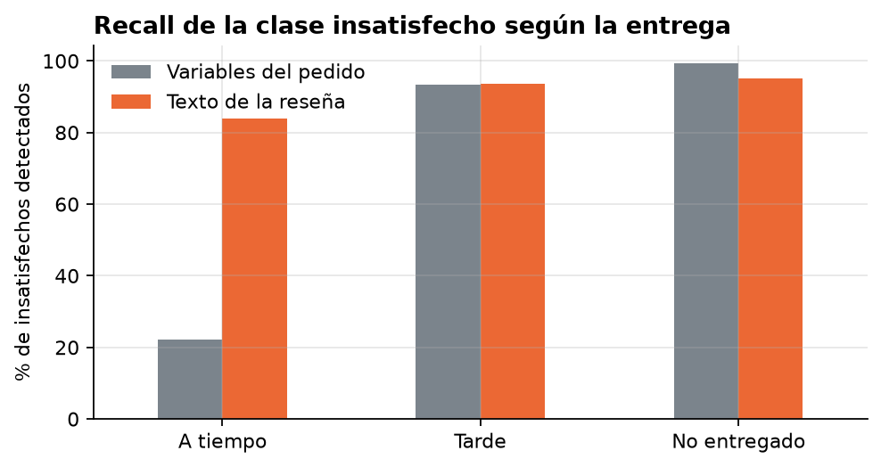

# Detección de clientes insatisfechos en Olist

Taller final de Ingeniería de la Información. Se aplica clasificación supervisada al dataset público de Olist, un marketplace brasileño, para identificar a los clientes insatisfechos (reseñas de 1 a 3 estrellas). El trabajo sigue las cuatro etapas de la analítica de datos: descriptiva, diagnóstica, predictiva y prescriptiva.

## Resultados

| Enfoque | Datos | Mejor modelo | F1 satisfecho | F1 insatisfecho | F1 > 0,7 en ambas clases |
|---|---|---|---:|---:|---|
| 1. Variables del pedido | 98.673 pedidos | Decision Tree (`max_depth=5`) | 0,870 | 0,510 | No (ningún modelo) |
| 2. Texto de la reseña | 40.775 pedidos con comentario | MLP (`hidden_layer_sizes=(100, 50)`) | 0,918 | 0,855 | Sí (los cinco modelos) |

Con las variables del pedido ningún clasificador alcanza el umbral. El análisis del error muestra que el modelo detecta a los insatisfechos cuyo pedido llegó tarde, pero no a los que lo recibieron a tiempo, que son dos tercios del total y cuyas quejas se refieren al producto. Al usar el comentario como entrada, con los mismos modelos y el mismo procedimiento, los cinco superan el umbral.



## Proceso

1. **Descriptiva.** El 22,9 % de los clientes queda insatisfecho, con picos en noviembre de 2017 y febrero-marzo de 2018.
2. **Diagnóstica.** El retraso multiplica la insatisfacción (17,2 % a tiempo, 65,4 % tarde, 85,6 % no entregado), pero el 67 % de los insatisfechos recibió a tiempo y se queja del producto.
3. **Predictiva, intento 1.** Con 13 variables del pedido el mejor F1 en la clase insatisfecho es 0,510. El modelo detecta el 93,3 % de los insatisfechos con entrega tarde y solo el 22,1 % de los que recibieron a tiempo.
4. **Decisión.** La información que falta está en el comentario, que deja el 63,5 % de los insatisfechos.
5. **Predictiva, intento 2.** Con bolsa de palabras del comentario los cinco modelos superan 0,7.
6. **Prescriptiva.** Recomendaciones sobre atención de reseñas, cumplimiento de entregas, temporadas pico y seguimiento a vendedores.

El razonamiento completo está en [docs/proceso.md](docs/proceso.md) y las decisiones de método en [docs/metodologia.md](docs/metodologia.md).

## Estructura

```
├── data/
│   └── raw/                  CSV de Olist (no incluidos, ver data/README.md)
├── docs/
│   ├── metodologia.md        datos, variables y procedimiento de evaluación
│   └── proceso.md            hallazgos y decisiones en orden
├── notebooks/
│   ├── 01_preparacion_y_exploracion.ipynb
│   ├── 02_modelo_variables_pedido.ipynb
│   └── 03_modelo_texto_resenas.ipynb
├── presentacion/
│   ├── sustentacion.pptx
│   └── sustentacion.pdf
├── reports/
│   ├── figuras/              gráficas generadas por los cuadernos
│   └── *.csv                 métricas y resultados de la búsqueda de hiperparámetros
└── src/
    ├── datos.py              carga de tablas y construcción del conjunto por pedido
    ├── modelos.py            clasificadores, búsqueda de hiperparámetros y evaluación
    └── graficos.py           estilo de las figuras
```

## Reproducir

Requiere Python 3.11 o superior.

```bash
python3 -m venv .venv
source .venv/bin/activate
pip install -r requirements.txt
```

Descargar los datos según [data/README.md](data/README.md) y ejecutar los cuadernos en orden desde la carpeta `notebooks/`:

```bash
jupyter notebook notebooks/
```

El cuaderno 03 lee un resultado del 02, por lo que deben ejecutarse en secuencia. Todos los procesos aleatorios usan `random_state=42`; con otras versiones de las librerías o en otro sistema operativo algunos valores pueden variar en el tercer decimal.

## Datos

[Brazilian E-Commerce Public Dataset by Olist](https://www.kaggle.com/datasets/olistbr/brazilian-ecommerce), publicado en Kaggle por Olist.
